# EcoTracker — Projeto Cidades ESG Inteligentes

**Fase 7 — Testes Automatizados** · Grupo 69 · Markus de Figueiredo Ferraz Wirz · RM561367 (markusfwirz@gmail.com)

API RESTful desenvolvida em **.NET Core 8** para o **Tema 4 — Governança e Compliance Ambiental**. A solução monitora emissões de carbono, controla licenças ambientais, registra auditorias de compliance e gerencia alertas ambientais automatizados.

Esta entrega acrescenta ao projeto a camada de **DevOps**: containerização, orquestração com Docker Compose (API + SQL Server, com volumes, redes e variáveis de ambiente) e um pipeline de **CI/CD no GitHub Actions** com build, testes, publicação de imagem e deploy automatizado em **staging** e **produção**.

## Arquitetura

- **Padrão MVVM**: Models, ViewModels (DTOs de request/response) e Controllers
- **Entity Framework Core 8** com SQL Server (fallback InMemory)
- **JWT Authentication** para endpoints protegidos
- **Paginação** em todos os endpoints de listagem
- **Validação** via Data Annotations nos ViewModels
- **Tratamento global de exceções** via middleware
- **Swagger/OpenAPI** para documentação interativa

## Controllers (4 endpoints RESTful)

| Controller | Rota Base | Descrição |
|---|---|---|
| `CarbonEmissionsController` | `/api/CarbonEmissions` | Monitoramento de emissão de carbono e compensação ambiental |
| `EnvironmentalLicensesController` | `/api/EnvironmentalLicenses` | Controle de licenças ambientais e alertas de renovação |
| `ComplianceAuditsController` | `/api/ComplianceAudits` | Registro de conformidade com normas ambientais e auditorias |
| `EnvironmentalAlertsController` | `/api/EnvironmentalAlerts` | Alertas automáticos (expiração, limites, etc.) |
| `AuthController` | `/api/Auth` | Autenticação JWT |

## Como Executar

### Requisitos
- .NET SDK 8.0+
- Docker (opcional)

### Localmente
```bash
cd src/EcoTracker
dotnet run
```
A API estará disponível em `http://localhost:5000`. Acesse `http://localhost:5000/swagger` para a documentação interativa.

### Docker (imagem isolada)
```bash
docker build -t ecotracker-api:local .
docker run -p 8080:8080 -e DisableHttpsRedirection=true ecotracker-api:local
```

### Docker Compose (API + SQL Server) — forma recomendada
```bash
cp .env.example .env          # ajuste senhas e portas
docker compose up -d --build  # sobe api + db
curl http://localhost:8080/health
# Swagger: http://localhost:8080/swagger
docker compose down           # (use -v para apagar os volumes)
```

Ambientes:
```bash
# staging  (Swagger habilitado, porta 8080)
docker compose -f docker-compose.yml -f docker-compose.staging.yml up -d

# produção (Swagger desabilitado, porta 9090, banco não exposto)
docker compose -f docker-compose.yml -f docker-compose.prod.yml up -d
```

## Autenticação

Faça login via `POST /api/Auth/login` para obter o token JWT:

| Usuário | Senha | Role |
|---|---|---|
| `admin` | `Admin@123` | Admin |
| `auditor` | `Auditor@123` | Auditor |
| `viewer` | `Viewer@123` | Viewer |

Use o token no header: `Authorization: Bearer <token>`

## Testes

```bash
dotnet test
```

17 testes de integração xUnit validando status code 200 para todos os controllers, mais a suíte **BDD/Gherkin** descrita na seção [Testes Automatizados — Fase 7](#testes-automatizados--fase-7).

## Banco de Dados

- **Desenvolvimento**: InMemory Database (dados seed incluídos)
- **Produção**: SQL Server (configure a connection string em `appsettings.json`)
- **Migrações**: `src/EcoTracker/Data/Migrations/`

Para aplicar migrações no SQL Server:
```bash
dotnet ef database update --project src/EcoTracker
```

---

# Testes Automatizados — Fase 7

Suíte **BDD** escrita em **Gherkin (português)** e executada com **Reqnroll** (sucessor open source do SpecFlow) sobre xUnit, cobrindo **todas as APIs** do EcoTracker com validação de **status code**, **corpo JSON** e **contrato via JSON Schema** (draft 2020-12, `JsonSchema.Net`).

## Relação com ESG

Os cenários protegem as regras de **governança e compliance ambiental**: cálculo da emissão líquida (emissão − compensação), monitoramento de licenças próximas do vencimento, auditorias com nota 0–100 e ações corretivas, alertas críticos com rastreabilidade da resolução, e **controle de acesso por perfil** (Admin, Auditor, Viewer) garantindo que apenas administradores excluam registros regulatórios. Os testes em memória dispensam banco e containers, reduzindo tempo e consumo de recursos no CI.

## Estrutura

```
tests/EcoTracker.BddTests/
├── Features/                 # cenários Gherkin (# language: pt)
│   ├── 01_Autenticacao.feature
│   ├── 02_EmissoesCarbono.feature
│   ├── 03_LicencasAmbientais.feature
│   ├── 04_AuditoriasCompliance.feature
│   ├── 05_AlertasAmbientais.feature
│   └── 06_Saude.feature
├── Schemas/                  # contratos JSON Schema das respostas
├── Steps/                    # step definitions (HTTP genérico, autenticação, massa de dados ESG)
├── Support/                  # ApiHost (em memória ou URL real), ApiContext, SchemaValidator, Hooks
├── reqnroll.json             # idioma pt-BR + relatório HTML
└── Dockerfile                # imagem do runner de testes
docker-compose.tests.yml      # adiciona o serviço bdd-tests à stack API + SQL Server
scripts/run-bdd-tests.sh      # execução local
scripts/run-bdd-tests-docker.sh # execução contra a stack Docker
```

## Cobertura das APIs

| API | Endpoints testados | Positivos | Negativos |
|---|---|---|---|
| Auth | `POST /api/Auth/login` | login dos 3 perfis + contrato do token | senha errada (401), payload inválido (400), token JWT inválido (401) |
| Emissões de carbono | `GET`, `GET {id}`, `POST`, `PUT {id}`, `DELETE {id}` | paginação, cálculo de `netEmission`, filtros, atualização, exclusão | validação (400), anônimo (401), Auditor excluindo (403), id inexistente (404) |
| Licenças ambientais | `GET`, `GET {id}`, `GET expiring`, `POST`, `PUT {id}`, `DELETE {id}` | filtro por status, licenças a vencer, suspensão, exclusão | campos obrigatórios (400), anônimo (401), Viewer excluindo (403), inexistente (404) |
| Auditorias de compliance | `GET`, `GET {id}`, `POST`, `PUT {id}`, `DELETE {id}` | resultado pendente, filtro por norma, aprovação condicional | nota fora de 0–100 (400), Viewer excluindo (403), inexistente (404) |
| Alertas ambientais | `GET`, `GET {id}`, `POST`, `PATCH {id}/resolve`, `DELETE {id}` | alerta crítico, filtro de abertos, resolução com notas | severidade inválida (400), resolução sem notas (400), anônimo (401), inexistente (404) |
| Health | `GET /health` | `Healthy` em menos de 2 s | rota desconhecida (404) |

**Total: 47 cenários** (incluindo os exemplos dos `Esquema do Cenário`), marcados com as tags `@positivo`/`@negativo`, `@contrato` e a tag do recurso.

Exemplo:

```gherkin
@positivo @contrato
Cenário: Registrar uma emissão calcula a emissão líquida (emissão - compensação)
  Dado que estou autenticado como "auditor"
  Quando eu envio uma requisição POST para "/api/CarbonEmissions" com o corpo:
    """
    {
      "companyName": "Usina Solar {unico}",
      "sector": "Energia Renovável",
      "emissionTonsCO2": 1200.5,
      "offsetTonsCO2": 200.5,
      "referenceYear": 2026,
      "referenceMonth": 9,
      "description": "Inventário GEE - escopo 1 e 2"
    }
    """
  Então o status code da resposta deve ser 201
  E a resposta deve respeitar o contrato "carbon-emission.schema.json"
  E a resposta deve conter o cabeçalho "Location"
  E o campo "companyName" da resposta deve ser "Usina Solar {unico}"
  E o campo "netEmission" da resposta deve ser "1000"
```

## Como executar

Pré-requisito: .NET SDK 8 (modo local) ou Docker (modo stack).

```bash
# 1) Local, API em memória (WebApplicationFactory) — não precisa de banco
./scripts/run-bdd-tests.sh
#   ou: dotnet test tests/EcoTracker.BddTests

# Somente os cenários negativos / somente um recurso
./scripts/run-bdd-tests.sh --filter "Category=negativo"
./scripts/run-bdd-tests.sh --filter "Category=licencas"

# 2) Contra uma API já em execução (local, staging...)
API_BASE_URL=http://localhost:8080 ./scripts/run-bdd-tests.sh

# 3) Stack completa em Docker: SQL Server + API + container de testes
./scripts/run-bdd-tests-docker.sh
#   equivalente a:
#   docker compose -f docker-compose.yml -f docker-compose.tests.yml up --build \
#     --abort-on-container-exit --exit-code-from bdd-tests db api bdd-tests
```

Relatórios gerados:

- `tests/EcoTracker.BddTests/TestResults/reqnroll_report.html` — relatório HTML com cada passo Gherkin (modo local)
- `tests/EcoTracker.BddTests/TestResults/bdd-results.trx` — resultado no formato TRX
- `TestResults/` na raiz — os mesmos relatórios no modo Docker

## Pipeline (GitHub Actions)

O workflow `.github/workflows/ci-cd.yml` ganhou dois jobs, que passam a ser pré-requisito para publicar a imagem e fazer deploy:

- **bdd-tests** — executa a suíte com a API em memória, publica um resumo no job e o relatório como artefato `bdd-test-report-inmemory`;
- **bdd-tests-docker** — sobe API + SQL Server com Docker Compose e executa a mesma suíte contra a stack real (artefato `bdd-test-report-docker`).


---

# DevOps — Fase 6

## Tecnologias utilizadas

| Camada | Tecnologia |
|---|---|
| Aplicação | .NET 8 / ASP.NET Core, EF Core 8, JWT, Swagger |
| Testes | xUnit (17 testes de integração com `WebApplicationFactory`) |
| Container | Docker (multi-stage build, imagem final `mcr.microsoft.com/dotnet/aspnet:8.0`, usuário não-root, HEALTHCHECK) |
| Orquestração | Docker Compose (serviços `api` + `db`, volumes nomeados, rede bridge dedicada, variáveis de ambiente) |
| Banco | SQL Server 2022 (container), InMemory como fallback quando não há connection string |
| CI/CD | GitHub Actions (`.github/workflows/ci-cd.yml`) + composite action `.github/actions/deploy-compose` |
| Registry | GitHub Container Registry (ghcr.io) |

## Pipeline de CI/CD

Arquivo: `.github/workflows/ci-cd.yml`. Dispara em `push` em qualquer branch, em `pull_request` e manualmente (`workflow_dispatch`).

```
build ──► test ──► docker ──► deploy-staging ──► deploy-production
```

| Job | O que faz |
|---|---|
| `build` | `dotnet restore` + `dotnet build -c Release` + `dotnet publish`; publica o artefato `ecotracker-publish` |
| `test` | `dotnet test -c Release` com relatório `.trx`; publica o artefato `test-results` (falha do teste quebra o pipeline) |
| `docker` | Build multi-stage com cache do Buildx e push para `ghcr.io/<repo>/ecotracker-api` nas tags `:<sha>` e `:latest` |
| `deploy-staging` | Ambiente `staging`: gera o `.env`, faz `docker compose -f docker-compose.yml -f docker-compose.staging.yml up -d` com a imagem recém-publicada, aguarda o `/health` e roda smoke test (login JWT + consulta autenticada) |
| `deploy-production` | Ambiente `production`, só após o staging passar: mesmo fluxo com `docker-compose.prod.yml` (Swagger desabilitado, banco sem porta publicada, limites de CPU/memória) na porta 9090 |

A lógica de deploy está isolada na composite action `.github/actions/deploy-compose`, reutilizada pelos dois ambientes apenas trocando o override do Compose, a porta e os segredos. Senhas (`MSSQL_SA_PASSWORD`, `JWT_KEY`) vêm de *secrets* do repositório; nenhum segredo real está versionado — apenas placeholders em `.env.example`.

## Containerização

`Dockerfile` multi-stage:

1. **build** (`sdk:8.0`) — restore em camada separada (cache de NuGet) e `dotnet build -c Release`;
2. **test** — estágio opcional que executa `dotnet test` dentro da imagem;
3. **publish** — `dotnet publish` sem apphost;
4. **final** (`aspnet:8.0`) — apenas o runtime + artefatos publicados, usuário `ecotracker` (uid 1001), `EXPOSE 8080` e `HEALTHCHECK` chamando `/health`. Imagem final de ~243 MB.

A aplicação ganhou um endpoint anônimo `GET /health` (ASP.NET Core Health Checks) e três chaves de configuração para operar em containers: `EnableSwagger`, `DisableHttpsRedirection` e `Database:StartupRetries` (retentativas até o SQL Server ficar disponível).

## Orquestração (Docker Compose)

`docker-compose.yml` define a stack base e os overrides de ambiente:

- **Serviços**: `api` (porta `${API_PORT}` → 8080) e `db` (SQL Server 2022);
- **Volumes**: `mssql-data` (dados do banco, `mssql-data-staging` / `mssql-data-prod` nos overrides) e `api-logs`;
- **Rede**: `ecotracker-net` (bridge) — a API acessa o banco pelo hostname `db`;
- **Variáveis de ambiente**: lidas do `.env` (`cp .env.example .env`) e injetadas como configuração do ASP.NET (`ConnectionStrings__DefaultConnection`, `Jwt__Key`, `EnableSwagger`, ...);
- **Dependência e saúde**: a API só inicia com `db` `service_healthy`; ambos têm `healthcheck` e `restart: unless-stopped`.

## Evidências

Build e testes automatizados:

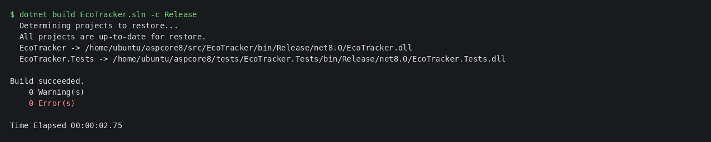
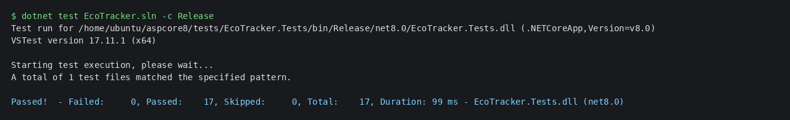

Subida da stack em staging, imagem/volumes/rede criados:

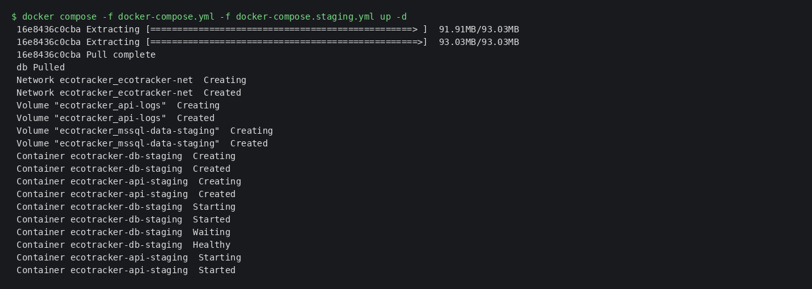
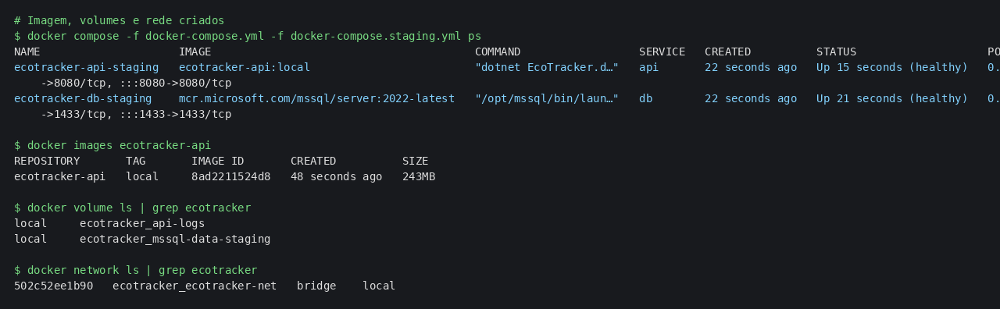

Aplicação funcionando em **staging** (health, login JWT, consulta autenticada e Swagger):

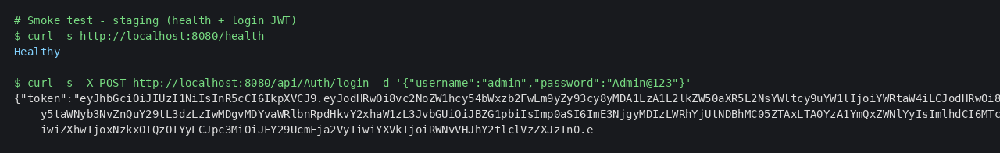
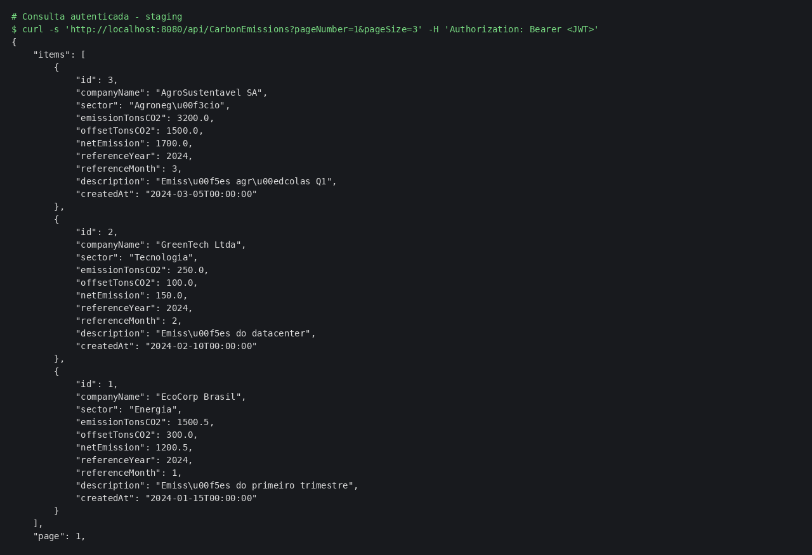
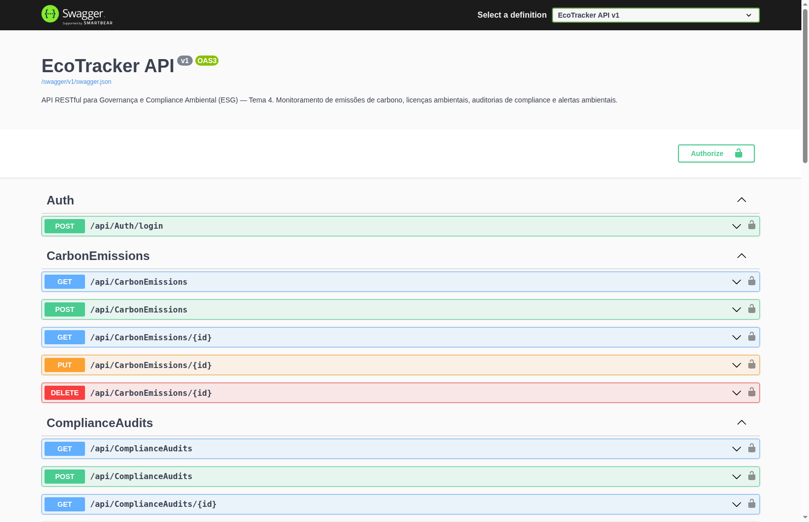

Aplicação funcionando em **produção** (porta 9090, Swagger retornando 404, banco sem porta publicada):

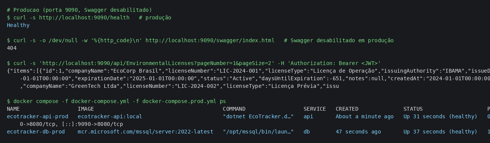

Validação dos arquivos de Compose e logs da API:

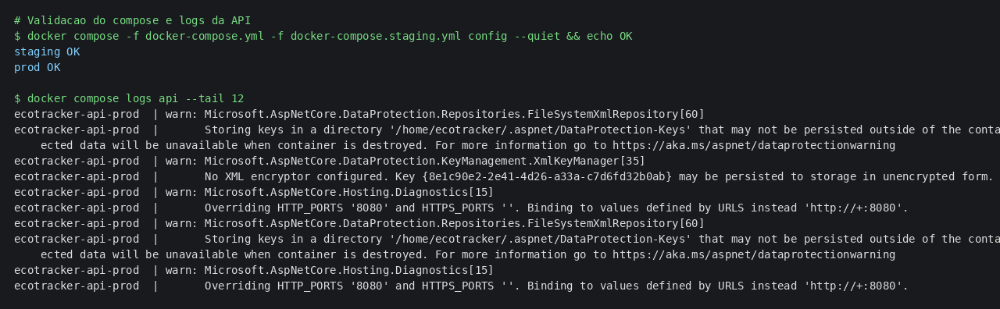

Execução real do pipeline no GitHub Actions (build → testes → imagem → staging → produção, todos verdes):

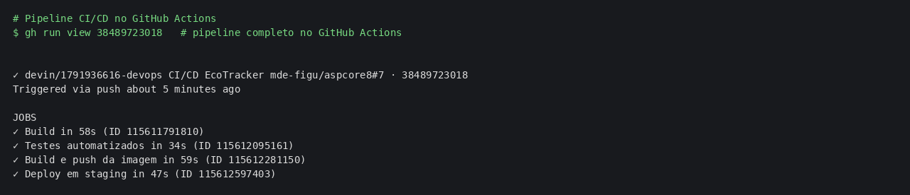
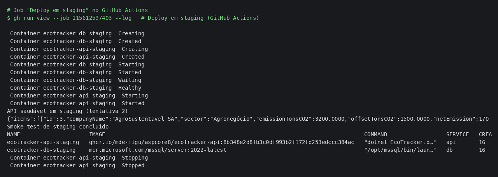
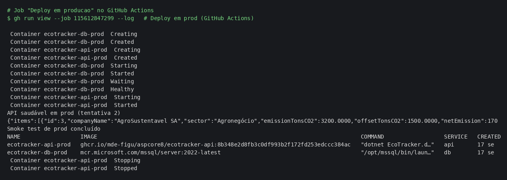

As execuções ficam em **Actions** do repositório: https://github.com/mde-figu/aspcore8/actions

## Checklist da entrega

- [x] Projeto compactado em `.zip` organizado
- [x] Dockerfile funcional (multi-stage, usuário não-root, healthcheck)
- [x] `docker-compose.yml` com volumes, variáveis de ambiente e rede (+ overrides de staging e produção)
- [x] Pipeline com build, testes e deploy automatizados (GitHub Actions)
- [x] README com instruções de execução e prints
- [x] Documentação técnica em PDF com evidências
- [x] Deploy realizado em staging e em produção
